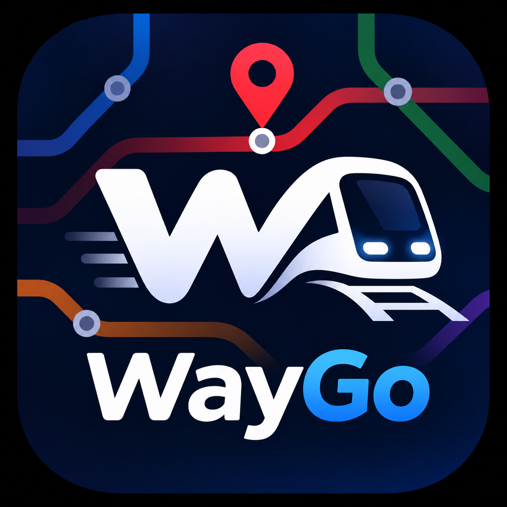
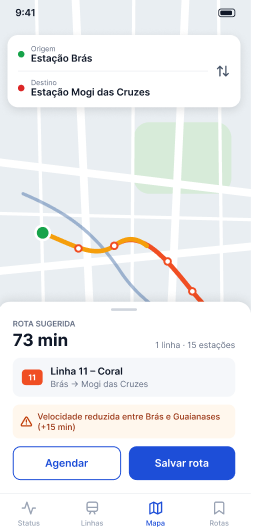
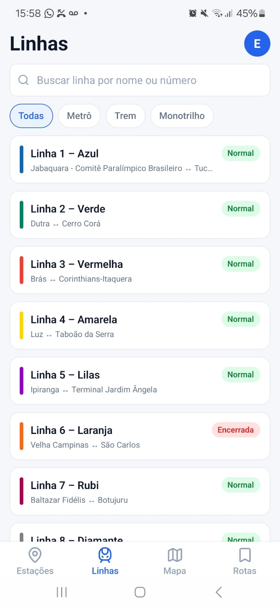
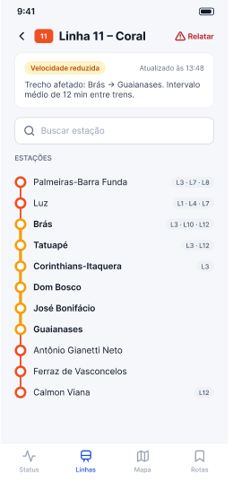

<p align="center">
  
</p>

<h1 align="center">WayGo</h1>

<p align="center">
  Status em tempo real do metrô e dos trens de São Paulo, cálculo de rotas que desviam de linhas
  com problema e lembretes na hora de sair de casa.
</p>

---

## Sobre o projeto

O WayGo junta em um só app o que o passageiro precisa antes de sair:

- **Status das linhas**: o backend consulta a API [Trilhos Agora](https://trilhosagora.com.br) a cada 2 minutos e guarda o histórico de cada mudança. O administrador também pode alterar o status manualmente.
- **Mapa da rede**: todas as linhas e estações; tocar numa estação abre "Sair daqui" / "Ir para cá".
- **Cálculo de rotas**: menor tempo, menos baldeações ou equilibrado. Linhas paralisadas ficam de fora, linhas lentas pesam mais, e há a opção de **rota alternativa**, que usa só linhas em operação normal.
- **Rotas salvas e agendamentos**: o passageiro salva os trajetos do dia a dia e agenda vários horários por rota; o app avisa antes da hora de sair.
- **Alertas**: aviso quando uma linha de uma rota salva muda de status.
- **Área do administrador**: lista de usuários, cadastro e edição de linhas e estações (inclusive posição no mapa e ordem das estações) e status manual.

| Mapa e rotas | Status das linhas | Estações | Rotas salvas |
|:---:|:---:|:---:|:---:|
|  |  |  |  |

O backlog completo (épicos, histórias e critérios de aceite) está em [docs/backlog-do-produto.md](docs/backlog-do-produto.md).

## Tecnologias

| Parte | Stack |
|---|---|
| **Backend** ([`backend/`](backend)) | Java 21, Spring Boot 4, Spring Security (JWT), Spring Data JPA / Hibernate, Flyway, OpenFeign, springdoc (Swagger) |
| **Banco** | Oracle Database 23 Free |
| **Mobile** ([`mobile/`](mobile)) | React Native + Expo (expo-router), TypeScript, NativeWind, TanStack Query, Zustand, react-native-maps, expo-notifications |
| **Infra** | Docker / Docker Compose |

O backend segue arquitetura hexagonal:

```
backend/src/main/java/com/bytestorm/waygo
├── domain/          # entidades, regras e cálculo de rotas (sem dependência de framework)
├── application/     # serviços (casos de uso), DTOs e caches
├── infrastructure/  # JPA, segurança JWT, cliente da API Trilhos Agora, agendador
└── presentation/    # controllers REST e tratamento de erros
```

As convenções do app estão em [mobile/AGENTS.md](mobile/AGENTS.md).

## Como rodar

### Opção 1: tudo com Docker (recomendado)

Requisitos: [Docker Desktop](https://www.docker.com/products/docker-desktop/) e, para usar no celular, o app **Expo Go** ([Android](https://play.google.com/store/apps/details?id=host.exp.exponent) / [iOS](https://apps.apple.com/app/expo-go/id982107779)).

```bash
cp .env.example .env               # defina HOST_IP com o IP da sua máquina na rede local
cp backend/.env.example backend/.env   # opcional: chave da API Trilhos Agora, segredo do JWT...
docker compose up -d --build
```

Isso sobe três contêineres:

| Serviço | Porta | O que é |
|---|---|---|
| `banco` | 1521 | Oracle Free. **Na primeira vez leva alguns minutos** para inicializar |
| `backend` | 8080 | API. Reinicia sozinho até o banco ficar pronto e então roda as migrations |
| `mobile` | 8081 | Servidor do Expo (Metro) |

Para abrir o app:

- **No celular:** rode `docker compose logs -f mobile`, leia o QR code com o Expo Go (Android) ou com a câmera (iOS). O celular precisa estar na mesma rede Wi-Fi do computador.
- **No navegador:** acesse <http://localhost:8081> (na web o mapa não é exibido).
- **No emulador Android:** abra o Expo Go no emulador e digite `exp://<HOST_IP>:8081`.

Comandos úteis:

```bash
docker compose logs -f backend   # acompanhar a API
docker compose restart mobile    # recarregar o Metro
docker compose down              # parar tudo
```

> **Dica:** no Windows, as alterações no código do app nem sempre são detectadas dentro do contêiner. Se o app não atualizar, rode `docker compose restart mobile`, ou rode o app fora do Docker (opção 2) enquanto desenvolve.

### Opção 2: rodando cada parte na máquina

Requisitos: Java 21, Node 20+ e Docker (só para o banco).

```bash
# 1. Banco
docker compose up -d banco

# 2. Backend (http://localhost:8080)
cd backend
cp .env.example .env
./mvnw spring-boot:run          # no Windows: mvnw.cmd spring-boot:run

# 3. App (em outro terminal)
cd mobile
cp .env.example .env
npm install
npx expo start
```

Mais detalhes do app (variáveis, emulador, backend hospedado e problemas comuns) em [mobile/README.md](mobile/README.md).

## Configuração

**Raiz (`.env`)**, usado pelo Docker Compose:

| Variável | Descrição |
|---|---|
| `HOST_IP` | IP da máquina na rede local. O Expo Go usa esse endereço para baixar o app e acessar a API |

**Backend (`backend/.env`)**, veja todos em [backend/.env.example](backend/.env.example). Os principais:

| Variável | Padrão | Descrição |
|---|---|---|
| `PORT` | `8080` | Porta da API |
| `DB_HOST` / `DB_PORT` / `DB_NAME` | `localhost` / `1521` / `FREEPDB1` | Banco Oracle (no Docker Compose o host é `banco`) |
| `DB_USERNAME` / `DB_PASSWORD` | `app` / `app123` | Usuário do banco |
| `TRILHOS_AGORA_API_KEY` | *(vazio)* | Chave da API Trilhos Agora, necessária para atualizar os status |
| `TRILHOS_AGORA_INTERVALO` | `PT2M` | Intervalo entre as consultas de status |
| `JWT_SEGREDO` | `segredo` | Segredo de assinatura dos tokens. **Troque em produção** |
| `JWT_EXPIRACAO_MINUTOS` | `60` | Validade do token |
| `CORS_ORIGENS_PERMITIDAS` | `*` | Origens liberadas para o app web |

**App (`mobile/.env`)**, veja [mobile/.env.example](mobile/.env.example). Com `EXPO_PUBLIC_API_HOST` vazio, o app usa automaticamente o IP da máquina que roda o Metro.

## Usuário administrador

A migration `V7` cria um administrador para testes:

| E-mail | Senha |
|---|---|
| `admin@gmail.com` | `Admin@123` |

Ao entrar com essa conta, o app mostra a aba **Admin**. Para promover outra conta, adicione a role `ADMINISTRADOR` na tabela `USUARIO_ROLE`.

## API

Com o backend rodando, a documentação interativa fica em <http://localhost:8080/swagger-ui.html>. Todas as rotas têm o prefixo `/api/v1`.

| Recurso | Endpoints | Acesso |
|---|---|---|
| Autenticação | `POST /auth/registro`, `POST /auth/login` | Público |
| Rede | `GET /rede` (linhas, estações, conexões e status) | Público |
| Linhas | `GET /linhas`, `GET /linhas/{id}`, `GET /linhas/{id}/estacoes`, `GET /linhas/{id}/status` | Público |
| Estações | `GET /estacoes` (paginado, com busca), `GET /estacoes/{id}`, `/{id}/linhas`, `/{id}/conexoes` | Público |
| Rotas | `GET /rotas/calcular?origem&destino&criterio&alternativa` | Público |
| Rotas salvas | `GET`, `POST /rotas` · `GET`, `PUT`, `DELETE /rotas/{id}` | Logado (só as próprias) |
| Agendamentos | `GET /rotas/agendamentos` · `GET`, `POST /rotas/{idRota}/agendamentos` · `GET`, `PUT`, `DELETE /rotas/agendamentos/{id}` | Logado (só os próprios) |
| Conta | `GET /usuarios/me` | Logado |
| Administração | `GET /usuarios` · `POST`, `PUT`, `DELETE /linhas` e `/estacoes` · `PUT /linhas/{id}/estacoes/ordem` · `PATCH /linhas/{id}/status` | Administrador |

Nos endpoints protegidos, envie o token no header `Authorization: Bearer <token>`.

## Testes

```bash
cd backend && ./mvnw test        # testes unitários do backend

cd mobile
npm test                         # testes unitários (Jest)
npm run typecheck                # TypeScript
npm run lint                     # ESLint
```
