# Diagrama de classes

```mermaid
classDiagram
    direction LR

    %% ===================== Entidades =====================
    class Usuario {
        -UUID id
        -String email
        -String senhaHash
        -Set~Role~ roles
        -LocalDateTime criadoEm
        +criar(email, senha, hasher, criadoEm) Usuario$
        +verificarSenha(senha, hasher) boolean
        +atualizarSenha(senhaAtual, novaSenha, hasher) void
        +redefinirSenha(novaSenha, hasher) void
        +adicionarRole(role) void
        +removerRole(role) void
        +possuiRole(role) boolean
        +isAdministrador() boolean
        +podeExcluirPropriaConta() boolean
    }

    class TokenRecuperacaoSenha {
        -Long id
        -UUID idUsuario
        -String codigoHash
        -int tentativas
        -LocalDateTime expiraEm
        -LocalDateTime usadoEm
        -LocalDateTime criadoEm
        +criar(idUsuario, codigo, hasher, agora) TokenRecuperacaoSenha$
        +estaValido(agora) boolean
        +confere(codigo, hasher) boolean
        +registrarTentativaFalha() void
        +marcarUsado(agora) void
        +foiCriadoHaMenosDe(intervalo, agora) boolean
    }

    class DispositivoUsuario {
        -Long id
        -UUID idUsuario
        -String tokenFcm
        -Plataforma plataforma
        -boolean alertasStatus
        -boolean ativo
        -LocalDateTime criadoEm
        -LocalDateTime atualizadoEm
        +criar(idUsuario, tokenFcm, plataforma, alertasStatus, agora) DispositivoUsuario$
        +registrarNovamente(idUsuario, plataforma, alertasStatus, agora) void
        +desativar(agora) void
        +pertenceA(outroUsuario) boolean
    }

    class Notificacao {
        -Long id
        -UUID idUsuario
        -TipoNotificacao tipo
        -String chave
        -String titulo
        -String corpo
        -Map~String, String~ dados
        -StatusNotificacao status
        -int tentativas
        -LocalDateTime proximaTentativaEm
        -String ultimoErro
        -LocalDateTime expiraEm
        -LocalDateTime enviadaEm
        -LocalDateTime criadoEm
        +criar(idUsuario, tipo, chave, titulo, corpo, dados, expiraEm, agora) Notificacao$
        +estaPendente() boolean
        +venceu(agora) boolean
        +expirarSeVencida(agora) boolean
        +marcarEnviada(agora) void
        +registrarFalha(erro, agora) void
    }

    class RotaSalva {
        -Long id
        -UUID idUsuario
        -Long idEstacaoOrigem
        -Long idEstacaoDestino
        -String nome
        -CriterioRota criterioRota
        -LocalDateTime criadoEm
        +criar(idEstacaoOrigem, idEstacaoDestino, nome, criterioRota, idUsuario, criadoEm) RotaSalva$
        +atualizarNome(nome) void
        +atualizarEstacaoOrigem(idEstacaoOrigem) void
        +atualizarEstacaoDestino(idEstacaoDestino) void
        +atualizarCriterioRota(criterioRota) void
    }

    class RotaAgendada {
        -Long id
        -Long idRotaSalva
        -int horarioPartidaMinutos
        -int antecedenciaMinutos
        -boolean ativa
        -Set~DiaSemana~ diasSemana
        -LocalDateTime criadoEm
        +criar(idRotaSalva, horarioPartidaMinutos, antecedenciaMinutos, diasSemana, criadoEm) RotaAgendada$
        +ativar() void
        +desativar() void
        +atualizarHorarioPartida(minutos) void
        +atualizarAntecedencia(minutos) void
        +adicionarDiaSemana(dia) void
        +removerDiaSemana(dia) void
        +executaNo(dia) boolean
    }

    class LinhaTransporte {
        -Long id
        -String codigo
        -String nome
        -String cor
        -String operadora
        -TipoTransporte tipoTransporte
        -boolean ativa
        +criar(nome, codigo, cor, operadora, tipoTransporte) LinhaTransporte$
        +ativar() void
        +desativar() void
        +renomear(novoNome) void
        +alterarCor(novaCor) void
        +alterarOperadora(novaOperadora) void
        +possuiCodigo(outroCodigo) boolean
    }

    class LinhaStatus {
        -Long id
        -Long linhaId
        -StatusOperacional status
        -String descricao
        -OrigemStatus origem
        -LocalDateTime atualizadoEm
        +registrarPelaApi(linhaId, status, descricao, momento) LinhaStatus$
        +registrarPeloAdministrador(linhaId, status, descricao, momento) LinhaStatus$
        +bloqueiaCirculacao() boolean
        +afetaTempo() boolean
        +mudouEmRelacaoA(anterior) boolean
    }

    class Estacao {
        -Long id
        -String nome
        -Coordenada coordenada
        -boolean ativa
        +criar(nome, coordenada) Estacao$
        +ativar() void
        +desativar() void
        +renomear(novoNome) void
        +relocalizar(novaCoordenada) void
        +possuiCoordenada() boolean
        +possuiNome(outroNome) boolean
    }

    class LinhaEstacao {
        -Long id
        -Long linhaId
        -Long estacaoId
        -int sequencia
        -boolean ativa
        +criar(linhaId, estacaoId, sequencia) LinhaEstacao$
        +ativar() void
        +desativar() void
        +reposicionar(novaSequencia) void
        +pertenceALinha(outraLinhaId) boolean
    }

    class ConexaoEstacao {
        -Long id
        -Long linhaEstacaoOrigemId
        -Long linhaEstacaoDestinoId
        -Integer tempoViagemSegundos
        -Integer distanciaMetros
        -boolean ativa
        +ativar() void
        +desativar() void
        +atualizarTempoViagem(segundos) void
        +atualizarDistancia(metros) void
        +podeSerPercorrida() boolean
    }

    class Baldeacao {
        -Long id
        -Long linhaEstacaoOrigemId
        -Long linhaEstacaoDestinoId
        -Integer tempoBaldeacaoSegundos
        -boolean ativa
        +ativar() void
        +desativar() void
        +atualizarTempo(segundos) void
        +podeSerUtilizada() boolean
    }

    %% ===================== Serviço de domínio =====================
    class CalculadoraRota {
        <<service>>
        +calcular(grafo, origemEstacaoId, destinoEstacaoId, parametros) Optional~CaminhoRota~
    }

    %% ===================== Value objects =====================
    class Coordenada {
        <<record>>
        BigDecimal latitude
        BigDecimal longitude
    }

    class GrafoRede {
        <<value object>>
        -Map~Long, NoRede~ nos
        -Map~Long, List~ArestaRede~~ arestasPorOrigem
        -Map~Long, LinhaTransporte~ linhas
        -Map~Long, Estacao~ estacoes
        +montar(linhas, estacoes, linhasEstacoes, conexoes, baldeacoes) GrafoRede$
        +no(linhaEstacaoId) NoRede
        +arestasDe(linhaEstacaoId) List~ArestaRede~
        +nosDaEstacao(estacaoId) List~NoRede~
        +nosDaLinha(linhaId) List~NoRede~
        +estacoesPorNome(nome) List~Estacao~
    }

    class NoRede {
        <<record>>
        Long linhaEstacaoId
        Long linhaId
        Long estacaoId
        int sequencia
    }

    class ArestaRede {
        <<record>>
        Long origem
        Long destino
        TipoConexao tipo
        int tempoSegundos
        int distanciaMetros
    }

    class CaminhoRota {
        <<record>>
        List~NoRede~ nos
        List~ArestaRede~ arestas
    }

    class ParametrosRota {
        <<record>>
        CriterioRota criterio
        double fatorLentidao
        int penalidadeBaldeacaoSegundos
        Map~Long, StatusOperacional~ statusPorLinha
        boolean somenteLinhasNormais
        +statusDa(linhaId) StatusOperacional
        +linhaDisponivel(linhaId) boolean
        +tempoEstimadoSegundos(aresta, origem) int
        +custo(aresta, origem) long
    }

    class StatusLinhaExterno {
        <<record>>
        String codigoLinha
        StatusOperacional status
        String descricao
    }

    class TokenAcesso {
        <<record>>
        String token
        Instant expiraEm
    }

    class ResultadoEnvioPush {
        <<record>>
        Tipo tipo
        String mensagem
        +sucesso() ResultadoEnvioPush$
        +tokenInvalido(mensagem) ResultadoEnvioPush$
        +falhaTemporaria(mensagem) ResultadoEnvioPush$
        +deuCerto() boolean
    }

    class Pagina~T~ {
        <<record>>
        List~T~ itens
        int numero
        int tamanho
        long totalItens
    }

    %% ===================== Enums =====================
    class Role {
        <<enumeration>>
        USUARIO
        MODERADOR
        ADMINISTRADOR
    }

    class CriterioRota {
        <<enumeration>>
        MENOR_TEMPO
        MENOS_BALDEACOES
        EQUILIBRADO
    }

    class DiaSemana {
        <<enumeration>>
        DOMINGO
        SEGUNDA
        TERCA
        QUARTA
        QUINTA
        SEXTA
        SABADO
    }

    class StatusOperacional {
        <<enumeration>>
        NORMAL
        VELOCIDADE_REDUZIDA
        PARALISADA
        OPERACAO_ENCERRADA
        OPERACAO_PARCIAL
        OPERACAO_TRANSITORIA
        ATIVIDADE_PROGRAMADA
        DESCONHECIDO
    }

    class OrigemStatus {
        <<enumeration>>
        ADMINISTRADOR
        API
    }

    class TipoTransporte {
        <<enumeration>>
        METRO
        TREM_METROPOLITANO
        MONOTRILHO
    }

    class TipoConexao {
        <<enumeration>>
        CONEXAO
        BALDEACAO
    }

    class Plataforma {
        <<enumeration>>
        ANDROID
        IOS
    }

    class TipoNotificacao {
        <<enumeration>>
        LEMBRETE_AGENDAMENTO
        STATUS_LINHA
    }

    class StatusNotificacao {
        <<enumeration>>
        PENDENTE
        ENVIADA
        EXPIRADA
    }

    class TipoResultadoPush["ResultadoEnvioPush.Tipo"] {
        <<enumeration>>
        SUCESSO
        TOKEN_INVALIDO
        FALHA_TEMPORARIA
    }

    %% ===================== Interfaces (portas) =====================
    class SenhaHasher {
        <<interface>>
        +gerarHash(senhaEmTexto) String
        +corresponde(senhaEmTexto, hash) boolean
    }

    class TokenProvider {
        <<interface>>
        +gerarToken(usuario) TokenAcesso
        +validarToken(token) Optional~String~
    }

    class GeradorCodigo {
        <<interface>>
        +gerar() String
    }

    class EnviadorEmail {
        <<interface>>
        +enviarBoasVindas(destinatario) void
        +enviarContaExcluida(destinatario) void
        +enviarCodigoRecuperacao(destinatario, codigo) void
        +enviarSenhaRedefinida(destinatario) void
    }

    class EnviadorPush {
        <<interface>>
        +enviar(tokenFcm, titulo, corpo, dados) ResultadoEnvioPush
    }

    class FonteStatusLinhas {
        <<interface>>
        +buscarStatusAtuais() List~StatusLinhaExterno~
    }

    %% ===================== Relacionamentos entre entidades =====================
    Usuario "1" --> "0..*" RotaSalva : possui
    Usuario "1" --> "0..*" DispositivoUsuario : registra
    Usuario "1" --> "0..*" Notificacao : recebe
    Usuario "1" --> "0..*" TokenRecuperacaoSenha : solicita
    RotaSalva "1" *-- "0..*" RotaAgendada : agendamentos
    RotaSalva "0..*" --> "2" Estacao : origem e destino
    LinhaTransporte "1" --> "0..*" LinhaStatus : histórico de status
    LinhaTransporte "1" --> "1..*" LinhaEstacao : estações em ordem
    Estacao "1" --> "1..*" LinhaEstacao : atendida por
    ConexaoEstacao "0..*" --> "2" LinhaEstacao : liga na mesma linha
    Baldeacao "0..*" --> "2" LinhaEstacao : liga entre linhas
    Estacao *-- Coordenada

    %% ===================== Uso de enums =====================
    Usuario --> Role
    RotaSalva --> CriterioRota
    RotaAgendada --> DiaSemana
    LinhaTransporte --> TipoTransporte
    LinhaStatus --> StatusOperacional
    LinhaStatus --> OrigemStatus
    DispositivoUsuario --> Plataforma
    Notificacao --> TipoNotificacao
    Notificacao --> StatusNotificacao
    ArestaRede --> TipoConexao
    ResultadoEnvioPush *-- TipoResultadoPush
    StatusLinhaExterno --> StatusOperacional
    ParametrosRota --> CriterioRota

    %% ===================== Grafo e cálculo de rotas =====================
    GrafoRede o-- NoRede
    GrafoRede o-- ArestaRede
    GrafoRede o-- LinhaTransporte
    GrafoRede o-- Estacao
    NoRede ..> LinhaEstacao : representa
    CaminhoRota o-- NoRede
    CaminhoRota o-- ArestaRede
    CalculadoraRota ..> GrafoRede : usa
    CalculadoraRota ..> ParametrosRota : usa
    CalculadoraRota ..> CaminhoRota : retorna

    %% ===================== Dependências das interfaces =====================
    Usuario ..> SenhaHasher : usa
    TokenRecuperacaoSenha ..> SenhaHasher : usa
    TokenProvider ..> Usuario
    TokenProvider ..> TokenAcesso : gera
    EnviadorPush ..> ResultadoEnvioPush : retorna
    FonteStatusLinhas ..> StatusLinhaExterno : retorna
```

## Legenda

| Símbolo | Significado |
|---|---|
| `-->` | Associação (ligação por id entre entidades, ou uso de enum) |
| `*--` | Composição: a parte não existe sem o todo (agendamentos de uma rota, coordenada da estação) |
| `o--` | Agregação: o grafo e o caminho reúnem nós e arestas |
| `..>` | Dependência: recebe como parâmetro ou devolve |
| `$` | Método estático (fábricas `criar`, `registrarPelaApi`...) |
| `<<record>>` | Record Java imutável (value object) |
| `<<interface>>` | Porta do domínio, implementada na infraestrutura (BCrypt, JWT, SMTP, FCM, API Trilhos Agora) |
