# Diagrama entidade-relacionamento

```mermaid
erDiagram
    %% ===================== Rede de transporte =====================
    LINHA_TRANSPORTE {
        NUMBER ID PK "identity"
        VARCHAR2 NOME "100, not null"
        VARCHAR2 CODIGO UK "20, not null"
        VARCHAR2 COR "20"
        VARCHAR2 OPERADORA "100, not null"
        VARCHAR2 TIPO_TRANSPORTE "30, not null"
        NUMBER ATIVA "0 ou 1, default 1"
    }

    ESTACAO {
        NUMBER ID PK "identity"
        VARCHAR2 NOME "150, not null"
        NUMBER LATITUDE "10,7, entre -90 e 90"
        NUMBER LONGITUDE "10,7, entre -180 e 180"
        NUMBER ATIVA "0 ou 1, default 1"
    }

    LINHA_ESTACAO {
        NUMBER ID PK "identity"
        NUMBER ID_LINHA FK "UK com ID_ESTACAO e com SEQUENCIA"
        NUMBER ID_ESTACAO FK "not null"
        NUMBER SEQUENCIA "maior que 0"
        NUMBER ATIVA "0 ou 1, default 1"
    }

    CONEXAO_ESTACAO {
        NUMBER ID PK "identity"
        NUMBER ID_LINHA_ESTACAO_ORIGEM FK "UK com destino"
        NUMBER ID_LINHA_ESTACAO_DESTINO FK "diferente da origem"
        NUMBER TEMPO_VIAGEM_SEGUNDOS "maior que 0"
        NUMBER DISTANCIA_METROS "maior que 0"
        NUMBER ATIVA "0 ou 1, default 1"
    }

    BALDEACAO {
        NUMBER ID PK "identity"
        NUMBER ID_LINHA_ESTACAO_ORIGEM FK "UK com destino"
        NUMBER ID_LINHA_ESTACAO_DESTINO FK "diferente da origem"
        NUMBER TEMPO_BALDEACAO_SEGUNDOS "maior que 0"
        NUMBER ATIVA "0 ou 1, default 1"
    }

    LINHA_STATUS {
        NUMBER ID PK "identity"
        NUMBER ID_LINHA FK "not null"
        VARCHAR2 STATUS "50, not null"
        VARCHAR2 DESCRICAO "255"
        VARCHAR2 ORIGEM "API ou ADMINISTRADOR"
        TIMESTAMP ATUALIZADO_EM "default systimestamp"
    }

    %% ===================== Usuários =====================
    USUARIO {
        VARCHAR2 ID PK "UUID, 36"
        VARCHAR2 EMAIL UK "255, único sem diferenciar maiúsculas"
        VARCHAR2 SENHA_HASH "255, BCrypt"
        TIMESTAMP CRIADO_EM "default systimestamp"
    }

    ROLE {
        NUMBER ID PK "identity"
        VARCHAR2 NOME UK "30"
    }

    USUARIO_ROLE {
        VARCHAR2 ID_USUARIO PK, FK "on delete cascade"
        NUMBER ID_ROLE PK, FK "not null"
    }

    TOKEN_RECUPERACAO_SENHA {
        NUMBER ID PK "identity"
        VARCHAR2 ID_USUARIO FK "on delete cascade"
        VARCHAR2 CODIGO_HASH "255, not null"
        TIMESTAMP EXPIRA_EM "not null"
        NUMBER TENTATIVAS "default 0"
        TIMESTAMP USADO_EM "null até ser usado"
        TIMESTAMP CRIADO_EM "default systimestamp"
    }

    %% ===================== Rotas e agendamentos =====================
    ROTA_SALVA {
        NUMBER ID PK "identity"
        VARCHAR2 NOME "100, not null"
        NUMBER ID_ESTACAO_ORIGEM FK "diferente do destino"
        NUMBER ID_ESTACAO_DESTINO FK "not null"
        VARCHAR2 CRITERIO "MENOR_TEMPO, MENOS_BALDEACOES ou EQUILIBRADO"
        VARCHAR2 ID_USUARIO FK "on delete cascade"
        TIMESTAMP CRIADO_EM "default systimestamp"
    }

    ROTA_AGENDADA {
        NUMBER ID PK "identity"
        NUMBER ID_ROTA_SALVA FK "on delete cascade"
        NUMBER HORARIO_PARTIDA_MINUTOS "0 a 1439"
        NUMBER ANTECEDENCIA_MINUTOS "0 a 1440"
        NUMBER ATIVA "0 ou 1, default 1"
        TIMESTAMP CRIADO_EM "default systimestamp"
    }

    AGENDAMENTO_DIA_SEMANA {
        NUMBER ID PK "identity"
        NUMBER ID_ROTA_AGENDADA FK "on delete cascade, UK com DIA"
        VARCHAR2 DIA "SEGUNDA a DOMINGO"
    }

    %% ===================== Notificações push =====================
    DISPOSITIVO_USUARIO {
        NUMBER ID PK "identity"
        VARCHAR2 ID_USUARIO FK "on delete cascade"
        VARCHAR2 TOKEN_FCM UK "512, not null"
        VARCHAR2 PLATAFORMA "ANDROID ou IOS"
        NUMBER ALERTAS_STATUS "0 ou 1, default 1"
        NUMBER ATIVO "0 ou 1, default 1"
        TIMESTAMP CRIADO_EM "default systimestamp"
        TIMESTAMP ATUALIZADO_EM "default systimestamp"
    }

    NOTIFICACAO {
        NUMBER ID PK "identity"
        VARCHAR2 ID_USUARIO FK "on delete cascade, UK com CHAVE"
        VARCHAR2 TIPO "LEMBRETE_AGENDAMENTO ou STATUS_LINHA"
        VARCHAR2 CHAVE "150, evita duplicadas"
        VARCHAR2 TITULO "150, not null"
        VARCHAR2 CORPO "1000, not null"
        VARCHAR2 DADOS "2000, JSON para o app"
        VARCHAR2 STATUS "PENDENTE, ENVIADA ou EXPIRADA"
        NUMBER TENTATIVAS "default 0"
        TIMESTAMP PROXIMA_TENTATIVA_EM "not null"
        TIMESTAMP EXPIRA_EM "not null"
        VARCHAR2 ULTIMO_ERRO "500"
        TIMESTAMP CRIADO_EM "default systimestamp"
        TIMESTAMP ENVIADA_EM "null até enviar"
    }

    %% ===================== Relacionamentos =====================
    LINHA_TRANSPORTE ||--o{ LINHA_ESTACAO : "tem estações"
    ESTACAO ||--o{ LINHA_ESTACAO : "atendida por"
    LINHA_ESTACAO ||--o{ CONEXAO_ESTACAO : "origem"
    LINHA_ESTACAO ||--o{ CONEXAO_ESTACAO : "destino"
    LINHA_ESTACAO ||--o{ BALDEACAO : "origem"
    LINHA_ESTACAO ||--o{ BALDEACAO : "destino"
    LINHA_TRANSPORTE ||--o{ LINHA_STATUS : "histórico de status"

    USUARIO ||--o{ USUARIO_ROLE : "tem"
    ROLE ||--o{ USUARIO_ROLE : "atribuída a"
    USUARIO ||--o{ TOKEN_RECUPERACAO_SENHA : "solicita"
    USUARIO ||--o{ ROTA_SALVA : "salva"
    ESTACAO ||--o{ ROTA_SALVA : "origem"
    ESTACAO ||--o{ ROTA_SALVA : "destino"
    ROTA_SALVA ||--o{ ROTA_AGENDADA : "agendada em"
    ROTA_AGENDADA ||--|{ AGENDAMENTO_DIA_SEMANA : "repete nos dias"
    USUARIO ||--o{ DISPOSITIVO_USUARIO : "registra"
    USUARIO ||--o{ NOTIFICACAO : "recebe"
```

## Observações

- **Exclusão em cascata:** excluir um usuário apaga os papéis, as rotas salvas (e com elas os agendamentos e os dias), os códigos de recuperação, os aparelhos e as notificações.
- **Booleanos** são `NUMBER(1)` com `CHECK (... IN (0, 1))`.
- **`LINHA_ESTACAO`** é a tabela associativa entre linha e estação, com a ordem (`SEQUENCIA`) da estação na linha. Conexões (mesma linha) e baldeações (entre linhas) ligam dois registros dela e formam o grafo usado no cálculo de rotas.
- **`NOTIFICACAO`** é histórico e fila de envio ao mesmo tempo. A chave única `(ID_USUARIO, CHAVE)` impede que a mesma notificação seja criada duas vezes.
- **Índices** além das PKs e UKs: `IDX_LE_ESTACAO`, `IDX_CE_ORIGEM`/`DESTINO`, `IDX_BAL_ORIGEM`/`DESTINO`, `IDX_LS_LINHA_ATUALIZADO`, `IDX_UR_ROLE`, `IDX_RS_ORIGEM`/`DESTINO`/`USUARIO`, `IDX_RA_ROTA_SALVA`, `IDX_TRS_USUARIO`, `IDX_DU_USUARIO` e `IDX_NOT_FILA`.
